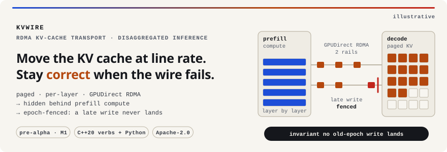
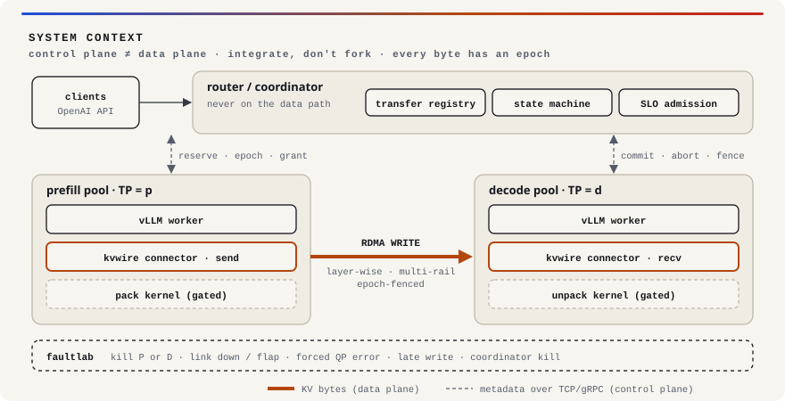
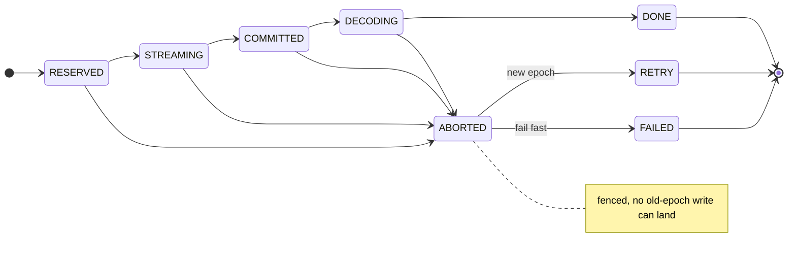

<!-- Banner and diagrams are generated by scripts/build_assets.py (light + dark). -->
<div align="center">

<picture>
  <source media="(prefers-color-scheme: dark)" srcset="docs/assets/banner-dark.svg">
  
</picture>

[](https://github.com/nareshns2004/kvwire-disaggregated-inference-engine/actions/workflows/ci.yml)
[](LICENSE)
[](pyproject.toml)
[](transport/)
[](pyproject.toml)
[](docs/MILESTONES.md)

**Moving the KV cache between prefill and decode GPUs at line rate, and staying correct when the network fails mid-transfer.**

[Problem](#1-the-problem) · [Scope](#2-what-kvwire-is-and-isnt) · [Thesis](#3-thesis-and-headline-numbers) · [Architecture](#4-architecture) · [Build](#6-building-it-incrementally-on-modest-hardware) · [Roadmap](#8-roadmap) · [Docs](#documentation)

</div>

kvwire is a GPUDirect RDMA transport, a KV re-layout kernel, and a failure-aware coordinator
for **disaggregated LLM inference**. It plugs into vLLM through its KV connector interface. It
does not replace the engine (the repository is
`kvwire-disaggregated-inference-engine`; the project and package are `kvwire`, ADR-0007). It replaces the part that moves bytes and the part that decides
what to do when moving bytes goes wrong.

> [!NOTE]
> **GitHub Project 2 · pre-alpha, milestone M1, pre-results.** This repository is built in public, milestone by
> milestone. Nothing below is a result yet. Every number this README will ever show links to
> a run directory under `bench/results/<run_id>/` with a full environment manifest, and sits
> next to the hardware ceiling it was measured against. Until then, the result cells say
> `—`. See the [roadmap](#8-roadmap).

---

## 1. The problem

LLM inference has two phases with opposite resource profiles:

| Phase | Bound by | Behaviour | What it hurts when colocated |
|---|---|---|---|
| **Prefill** (process the prompt) | Compute (tensor cores) | Large, bursty, one pass over all prompt tokens | Stalls every in-flight decode → **TPOT spikes** |
| **Decode** (generate tokens) | HBM bandwidth | Small, steady, latency-sensitive, one token per step | Delays new prefills → **TTFT spikes** |

Running both on the same GPUs makes them interfere. Chunked prefill (Sarathi-Serve) reduces the
interference but doesn't remove it. **Disaggregation** runs prefill and decode on separate GPU
pools, so each can be batched and scaled for its own bottleneck (DistServe, Splitwise, Mooncake).

Disaggregation trades an interference problem for a **data-movement problem**. The KV cache
produced by prefill has to cross the network before decode can start, and it sits directly on
the time-to-first-token (TTFT) critical path.

### Why that data movement is hard

*These figures are calculations, not measurements. Reproduce them with `kvwire kv-size`.*

| | Llama-3.1-8B (32 L, 8 KV heads, d=128, bf16) |
|---|---|
| KV per token | 2 × 32 × 8 × 128 × 2 B = **128 KiB** |
| KV for a 4K-token prompt | **512 MiB** |
| One paged block (16 tokens), one layer | 16 × 2 × 8 × 128 × 2 B = **64 KiB** |
| Contiguous regions for a 4K prompt (256 blocks × 32 layers) | **8,192** × 64 KiB if K and V are interleaved per block, or **16,384** × 32 KiB if K and V are separate tensors. Which one you get depends on vLLM's attention-backend KV layout. |

vLLM stores KV in **pages** (blocks), laid out **per layer**, and scattered across GPU memory.
Streaming it layer-by-layer to overlap with compute makes this a **small-message,
high-work-request-rate, scatter-gather problem**. It is not a bulk `memcpy`. At these sizes a
naive "one RDMA WRITE per block" design runs into NIC message-rate limits, doorbell costs, and
completion-processing overhead long before it reaches line rate.

### The failure problem nobody publishes

> A transfer times out. The decode side frees its KV blocks and hands them to another request.
> Then a *late* RDMA WRITE from the timed-out transfer lands in those blocks.
> **The second request's output is silently corrupted.** No error is raised anywhere.

This **stale-write hazard** follows directly from one-sided RDMA: the NIC writes into memory the
remote CPU believes it owns. Preventing it takes verbs-level mechanisms, either memory-window
invalidation or QP-state fencing bounded by the IB retransmit horizon. Detecting it after the
fact is not enough. Most public disaggregation systems report throughput. Very few report
behaviour under fault, and fewer still report *zero corruption* as a tested invariant.
See [`docs/TRANSPORT.md §5`](docs/TRANSPORT.md) and [`docs/FAULT_MATRIX.md`](docs/FAULT_MATRIX.md) (K07).

---

## 2. What kvwire is and isn't

**It is** the layer a verbs-level engineer builds, on top of a mature engine:

| Area | Existing work | What kvwire adds |
|---|---|---|
| Engine | vLLM, SGLang, Dynamo | **Nothing.** Plugs into vLLM (ADR-0001). |
| KV transport | NIXL, Mooncake Transfer Engine, UCX, LMCache | A verbs transport tuned for **paged per-layer small messages**: WR batching, SGE lists, doorbell coalescing, selective signalling, multi-rail, layer-wise streaming. Measured as **% of `ib_write_bw`**. |
| Correctness under fault | Rarely specified or measured | **Epoch fencing** that makes stale writes impossible, QP error recovery, a fault matrix, and a **zero-corruption gate** |
| Heterogeneous layouts | Sparsely documented | A Triton **pack / re-layout kernel** for prefill TP ≠ decode TP. It merges only if it measurably improves TTFT (ADR-0003). |
| Evaluation | Papers pick favourable regimes | A **crossover analysis** against the strongest baseline (colocated vLLM with chunked prefill), **including where disaggregation loses** |

**It is not** (non-goals):
- a new inference engine, scheduler framework, or model runtime;
- an attention kernel (it doesn't compete with FlashAttention or FlashInfer);
- speculative decoding, quantization, or prefix-cache routing research;
- a claim about any scale beyond what was actually run.

If the M1 prior-art review ([`docs/prior_art.md`](docs/prior_art.md)) finds that NIXL or Mooncake
already cover fencing and fault behaviour with published measurements, the project re-scopes to
whatever gap remains, and says so publicly.

---

## 3. Thesis and headline numbers

```
TTFT_disagg ≈ queue_P + prefill + exposed_transfer + queue_D + first_decode_step
```

With layer-wise streaming, layer *l*'s KV is sent while layer *l+1* computes. `exposed_transfer`
then shrinks to roughly the last layer plus completion signalling. The transport's job is to keep
that residual **small and stable at p99**, with small scattered messages, under contention,
while hardware fails.

kvwire has to earn **three headline numbers**. Each is reported against a ceiling or a baseline,
never on its own:

| # | Headline | Compared against | Initial target (hypothesis) | Result |
|---|---|---|---|---|
| 1 | **Transport efficiency**: paged per-layer KV throughput, GPU→GPU | perftest `ib_write_bw --use_cuda` large-message peak (also reported vs the ceiling at the region size) | ≥ 85% of ceiling | — |
| 2 | **TTFT**: p50/p99, with a stacked decomposition | kvwire-TCP, reference connector (NIXL), colocated vLLM | Lower than TCP at every prompt ≥ 1K tokens | — |
| 3 | **Request success under fault**, plus a **hard zero-corruption gate** | Reference connector under an identical fault schedule | ≥ 99.9% success; **0** corrupted outputs | — |

Hypotheses (each gets confirmed or refuted in writing, see [`docs/PROJECT_BRIEF.md §4`](docs/PROJECT_BRIEF.md)):
- **H1.** Naive per-block WRITE falls well short of line rate. WR batching, SGE coalescing, or
  packing close most of the gap. (Known risk: modern NICs may already be near peak at 64 KiB
  messages, so the efficiency-vs-size sweep comes first and decides the regime tested.)
- **H2.** With layer-wise streaming, exposed transfer is a small fraction of TTFT on RDMA for
  prompts ≥ 1K tokens. On TCP it is not small.
- **H3.** Disaggregation beats chunked-prefill colocation on goodput-per-GPU **only** when prompts
  are long relative to outputs and TPOT SLOs are tight. It **loses** on short-prompt/long-output
  chat. The crossover is measured and published.

The full metric list (10 metrics) is in [`docs/PROJECT_BRIEF.md §6`](docs/PROJECT_BRIEF.md), and the
canonical definitions are in [`docs/EVALUATION.md`](docs/EVALUATION.md).

---

## 4. Architecture

<picture>
  <source media="(prefers-color-scheme: dark)" srcset="docs/assets/architecture-dark.svg">
  
</picture>

Design principles:
1. **Integrate, don't fork.** vLLM stays pinned. All version-specific code lives in `kvwire/connector/`.
2. **Control plane ≠ data plane.** Metadata goes over TCP/gRPC; KV bytes go over RDMA only.
3. **Hide transfer behind compute.** Transfers are per layer and triggered by CUDA events.
4. **Every byte has an owner and an epoch.** Only one transfer generation can write a block at a time.
5. **Correctness gates performance.** Greedy outputs must match the reference, or the change doesn't merge.

Transfer state machine (coordinator; the table is implemented in
[`kvwire/coordinator/state_machine.py`](kvwire/coordinator/state_machine.py)). Every live state
can abort, and `ABORTED` always fences before a retry or a failure, so blocks never return to
an allocator while an old-epoch write could still land. A retry is a new transfer with a
strictly greater epoch.



Details: [`docs/ARCHITECTURE.md`](docs/ARCHITECTURE.md) · [`docs/TRANSPORT.md`](docs/TRANSPORT.md) · [`docs/FAULT_MATRIX.md`](docs/FAULT_MATRIX.md)

---

## 5. Repository map

```
kvwire/                    Python package (control plane, CPU-testable)
  schemas/                   versioned wire schemas: TransferDesc, TransferEvent, RequestTimeline, FaultInjection
  coordinator/               router, transfer registry, transfer state machine, membership
  connector/                 vLLM KV-connector adapter (the only vLLM-version-specific code)
  transport/                 Python-side Transport interface, TCP control variant, native loader
  topology/                  GPU↔NIC PCIe/NUMA affinity → topology.json
  kvcalc/                    KV-size and message-size calculator (implemented)
  sim/                       simulated engine for CPU-only coordinator tests
  cli.py                     `kvwire` command-line entry point
transport/                 C++20 verbs transport (RAII, no exceptions across ABI, no hot-path alloc)
  include/kvwire/transport/  public headers: status, device, mr, qp, fence, strategy, transport
  src/                       implementations (stubs until M2)
  tests/  bench/  python/    loopback/rxe tests · microbenchmarks vs perftest · pybind11 module
kernels/                   Triton pack/unpack + PyTorch reference + benchmarks (M4, gated)
faultlab/                  fault scenarios (YAML), injection mechanisms, ground-truth ledger
bench/                     load generator, serving scenarios, report generator, results/ (raw gitignored)
scripts/                   env manifest, topology dump, perftest ceiling sweep
dashboards/                Grafana (Should)
tests/                     unit/ integration/ gpu/ multinode/ fixtures/
docs/                      brief, prior art, architecture, transport, evaluation, fault matrix, ADRs, open questions
```

---

## 6. Building it incrementally, on modest hardware

The repo is split so that **most of the correctness-critical logic runs on a laptop**. Only the
performance claims need real hardware.

| Tier | Needs | What you can build and test |
|---|---|---|
| **0 · Laptop** | Python ≥ 3.10 | schemas, KV calculator, coordinator state machine, registry, router policy, simulated engine, faultlab ledger, loadgen, report generator |
| **1 · Laptop + rdma-core** | `libibverbs-dev`, CMake, a C++20 compiler, SoftRoCE (`rxe`) | transport logic: QP lifecycle, error paths, fencing semantics, **K06/K07 as logic tests**. rxe results are labelled *non-performance*. |
| **2 · 1 GPU node + RDMA NIC** | CUDA, GPUDirect (dmabuf or peermem), perftest | ceilings, GPU MR registration, loopback throughput, pack kernel |
| **3 · 2+ GPU nodes** | a real fabric | every headline number: efficiency, TTFT, faults, goodput crossover |

```bash
# Tier 0 (lightweight: pytest, ruff, mypy only; needs uv)
make setup                     # .venv + dev deps + pre-commit hooks
make check                     # ruff, mypy --strict, CPU tests, number-provenance guard
.venv/bin/kvwire kv-size --preset llama-3.1-8b --prompt 4096 --block-size 16

# Tier 1+ (when you have the toolchain: CMake >= 3.22, C++20, optionally libibverbs-dev)
make transport                 # CMake; builds the verbs backend only if libibverbs is found
make test-transport            # C++ unit tests
make test-rxe                  # transport logic over SoftRoCE (non-performance)
```

Heavy dependencies (vLLM, PyTorch, Triton, pybind11) are **optional extras** (`.[gpu]`, `.[vllm]`)
and are never imported at package import time.

---

## 7. Methodology: the parts that stop numbers from lying

- **Ceilings first.** Every transport number comes with the `ib_write_bw` / `ib_write_lat` ceiling
  for the same NIC, message size, QP count, and GPU-vs-host memory mode (`make ceiling`).
  Efficiency is reported against both the ceiling at the region size and the large-message
  peak; the headline uses the peak.
- **The strongest baseline.** Colocated vLLM with **chunked prefill on and tuned**, at **GPU-count
  parity** with the disaggregated setup. The P:D ratio is swept, and the best ratio is reported.
- **Goodput, not throughput.** The metric is the maximum request rate at ≥ 90% joint TTFT+TPOT SLO
  attainment, also reported **per GPU** (DistServe's framing). SLO values are pinned before
  any baseline runs.
- **Statistics.** ≥ 10 min steady state, ≥ 3 interleaved repetitions, bootstrap CIs on percentiles,
  ≥ 20 trials per fault class, and fixed seeds.
- **Correctness gate.** Greedy decoding compared against colocated reference outputs, with the
  numerics tolerance measured first. Any mismatch blocks the release.
- **Provenance.** `bench/results/<run_id>/` holds the config, env manifest (GPU, driver, CUDA, vLLM
  commit, NIC firmware, rdma-core, GPUDirect mode, PCIe topology hash), raw timelines, and the
  ceiling sweep. Reports are script-generated, and no number is hand-typed.

Full protocol: [`docs/EVALUATION.md`](docs/EVALUATION.md).

---

## 8. Roadmap

| M | Milestone | Key exit criterion | Status |
|:---|:---|:---|:---|
| **M1** | Baselines, hardware ceilings, harness, prior-art gate | perftest ceilings recorded; C0 goodput curve for ≥ 2 workloads; ADR-0001 pinned, ADR-0002 decided | ◐ in progress |
| M2 | RDMA KV transport (C++) | efficiency-vs-size curve for 4 strategies; K06 + K07 pass with zero corruption | ○ planned |
| M3 | Prefill/decode split integrated into vLLM | TTFT decomposition: TCP vs RDMA vs reference; correctness gate green | ○ planned |
| M4 | KV re-layout kernel (Triton), gated | ADR-0003 decided with data: merge, or publish as a negative result | ○ planned |
| M5 | Failure-aware coordination, SLO scheduling, goodput | fault-matrix Must rows recovered; crossover heatmap; H1–H3 answered | ○ planned |
| M6 | Write-up and release | every public number links to a run id; an outsider can reproduce the ceiling sweep and D1-vs-D3 | ○ planned |

Details: [`docs/MILESTONES.md`](docs/MILESTONES.md). Decisions: [`docs/adr/`](docs/adr/).

---

## 9. Prior art

kvwire builds on, and is measured against: **DistServe** (OSDI '24), **Splitwise** (ISCA '24),
**Mooncake** (FAST '25), **TetriInfer**, **Sarathi-Serve** (chunked prefill), **NVIDIA Dynamo / NIXL**,
**vLLM disaggregated prefill / KV connectors**, **SGLang PD disaggregation**, **LMCache**, and **llm-d**.
For each one, [`docs/prior_art.md`](docs/prior_art.md) records its mechanism, its gap, and what kvwire reuses.

First findings (draft, sourced in that file): Mooncake's Transfer Engine and NIXL document
retry, rerouting and teardown on failure, but neither documents preventing a late write from
an aborted transfer landing in reused blocks, or publishes zero-corruption results under
fault. The go / re-scope decision is still open.

---

## 10. Honest limitations (stated up front)

- The scale is whatever hardware was actually available. Per-GPU normalisation is used, and nothing
  is extrapolated without a label.
- Some faults are **induced** (a test hook forces a QP into ERR) rather than organic. Every fault is labelled R/I/S.
- A decode-node failure *after* commit means **recomputing prefill**, because there's no KV
  replication. That cost is measured, not hidden.
- Where the reference connector or colocated serving wins, the report says so.

---

## Documentation

| Doc | Contents |
|---|---|
| [PROJECT_BRIEF](docs/PROJECT_BRIEF.md) | Problem, positioning, hypotheses, targets, scope, risks |
| [prior_art](docs/prior_art.md) | Existing systems, what kvwire reuses, the gap decision |
| [ARCHITECTURE](docs/ARCHITECTURE.md) | Components, request lifecycle, schemas, failure semantics |
| [TRANSPORT](docs/TRANSPORT.md) | Verbs design: registration, small-message strategies, completion, fencing |
| [FAULT_MATRIX](docs/FAULT_MATRIX.md) | Fault classes K01–K12: injection, detection, required behaviour |
| [EVALUATION](docs/EVALUATION.md) | Metric definitions, systems under test, workloads, protocol |
| [MILESTONES](docs/MILESTONES.md) | M1–M6 deliverables and exit criteria |
| [ENVIRONMENT](docs/ENVIRONMENT.md) | Hardware, allowlist, provenance; generated env manifest |
| [ADRs](docs/adr/) | Architecture decisions and their status |
| [OPEN_QUESTIONS](docs/OPEN_QUESTIONS.md) | Open design questions, and where resolved ones were settled |

## Related artifacts

kvwire is one half of a two-repo portfolio on GPU networking and distributed systems:
[**goodput**](https://github.com/nareshns2004/goodput-fault-tolerant-training-orchestrator)
(GitHub Project 1) covers *reliability* at scale (cross-layer fault attribution for
multi-node training), and kvwire (GitHub Project 2) covers *efficiency* at scale. They share
the fault-injection discipline and the real / induced / synthetic labels (ADR-0006).

kvwire's measured runs feed **Hugging Face Project 2**
([ADR-0007](docs/adr/0007-open-questions-resolved.md)):

| Artifact | Role | Status |
|---|---|---|
| [`rdma-kv-transfer-traces`](https://huggingface.co/datasets/nareshns2004/rdma-kv-transfer-traces) | Dataset (CC-BY-4.0): `transfers`, `transfers_raw`, `layer_timelines`, `ceilings`, `prefill`, `environments`. Built by `kvwire export`, which refuses any row without a same-config ceiling. v0 = ceilings + environments from the M1 sweep. | Planned (M1) |
| [`disagg-kv-explorer`](https://huggingface.co/spaces/nareshns2004/disagg-kv-explorer) | Space: efficiency vs message size, transfer vs recompute, break-even, exposed transfer, from measured rows only (no serving simulation) | Planned (after dataset v1) |

Nothing is uploaded until real, run-id-backed rows exist on hardware cleared for
publication.

## Contributing, security, licence

- [CONTRIBUTING.md](CONTRIBUTING.md): hardware tiers, conventions, evidence rules, DCO sign-off.
- [SECURITY.md](SECURITY.md): private reporting, the cross-request corruption threat model,
  and faultlab's safety rules.
- Licensed under the [Apache License 2.0](LICENSE).
